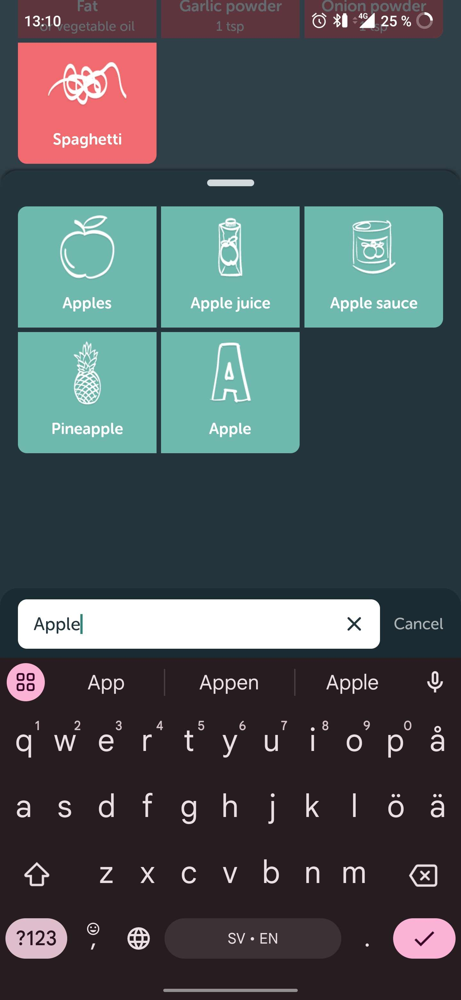
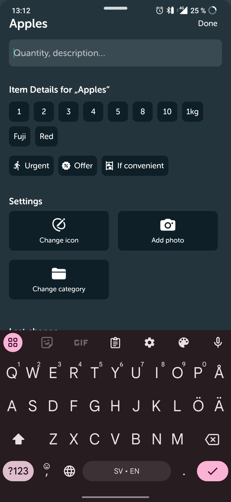
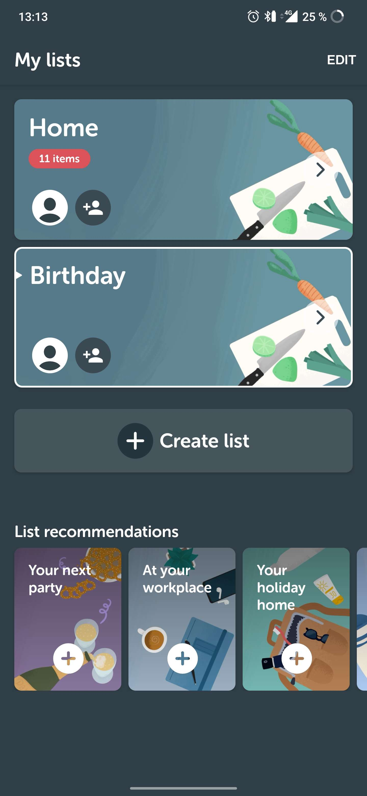
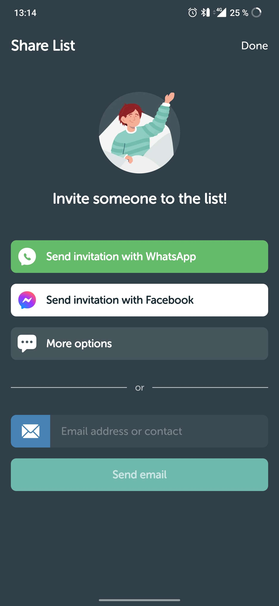
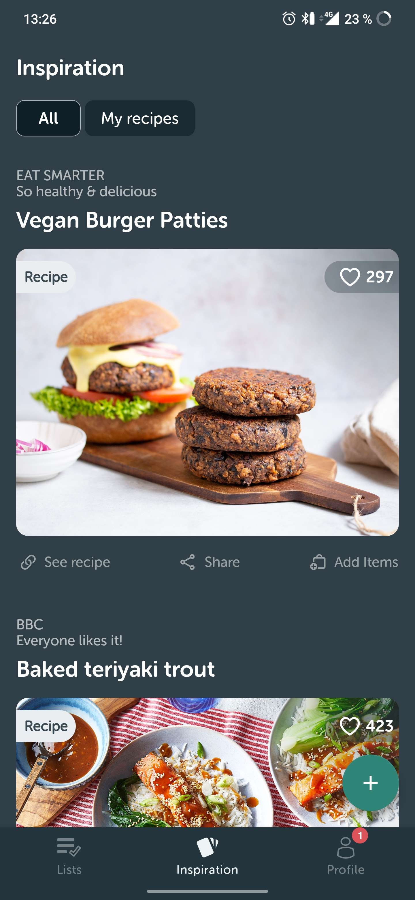
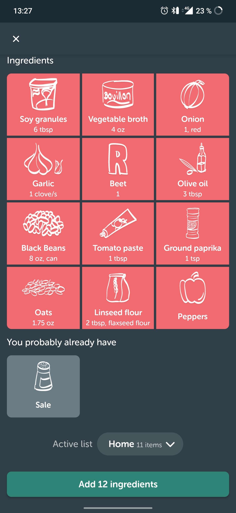
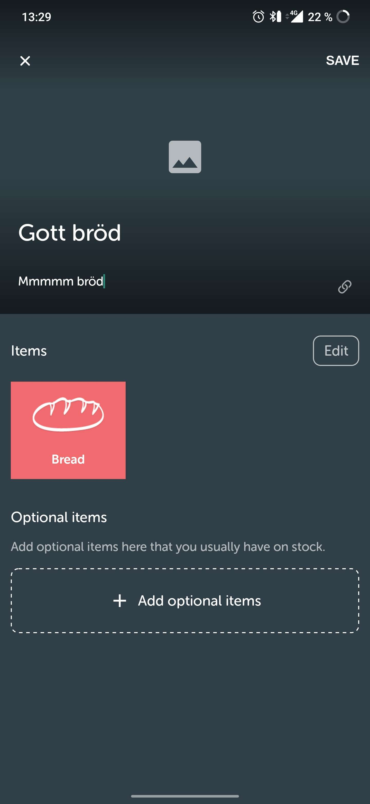
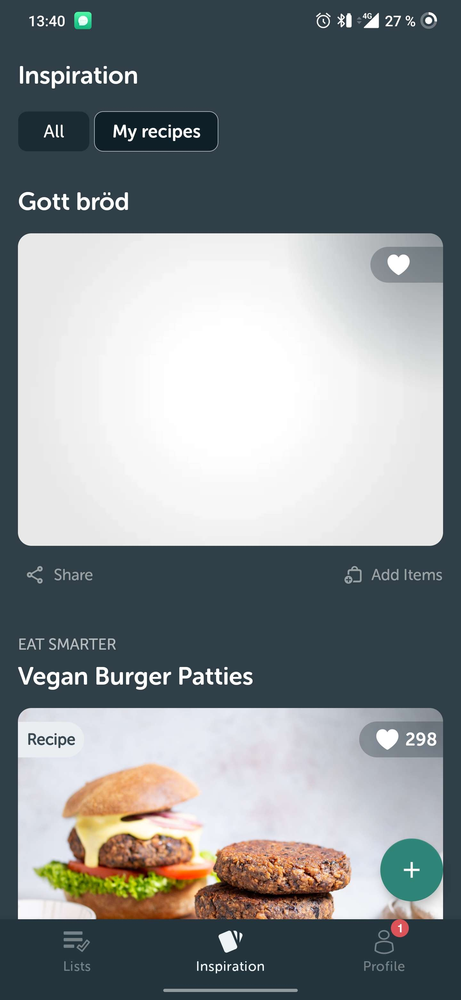

# Konkurrentsanalys
Jag har analyserat <i>Bring!</i> som är en app där man skapar inköpslistor, specifikt inköpslistor för mat. Efter analys så har jag identifierat åtta stycken måste krav som jag anser att varje bra inköpslisteapp måste ha samt fyra egna krav som jag anser saknas hos <i>Bring!</i> 

## Måste krav

### 1.
Användaren ska enkelt kunna lägga till varor i en inköpslista för att veta vad som ska inhandlas.
<!---->

### 2.
Användaren ska kunna bestämma hur mycket av en vara som ska läggas till i inköpslistan för att veta hur mycket av varan som ska inhandlas.

### 3.
Användaren ska kunna skapa flera olika inköpslistor för att kunna organisera flera olika inhandlingar.

### 4.
En användare ska ha möjligheten att bjuda in en till användare för att se inköpslistan.

### 5.
Användaren ska kunna hitta recept för att få inspiration för vad man kan laga.

### 6.
Användaren ska snabbt kunna lägga till ingridienser från ett recept i en inköpslista för att inte själv behöva göra det manuelt.

### 7.
En användare ska kunna lägga till sina egna recept i appen för att snabbt kunna lägga in dess ingridienser i en inköpslista.

### 8. 
Användaren ska kunna spara undar recept som den gillar för att enkelt kunna hitta det igen senare.'

## Egna krav

### 1.
Den användaren som skapar en inköpslista som delas med andra ska kunna kontrollera hur de andra användaren interagerar med listan. Dvs. om de andra användarna kan ändra listans inehåll, kommentera på listan, eller enbart visa listan.

### 2. 
Användare ska kunna dela sina egna recept med andra användare för att öka mängden recept som alla användare kan ta inspiration från.

### 3. 
En användare ska kunna följa en annan användare för att alltid veta när denna användaren har skapat ett nytt recept.

### 4. 
När användaren skapar en ny inköpslista så läggs vissa förbestämda varor direkt in för att om användaren ska handla t.ex. mjölk och smör varje gång kan det läggas in automatiskt så att användaren sparar tid. De förbestämda varorna som läggs in kan justeras av användaren. 

